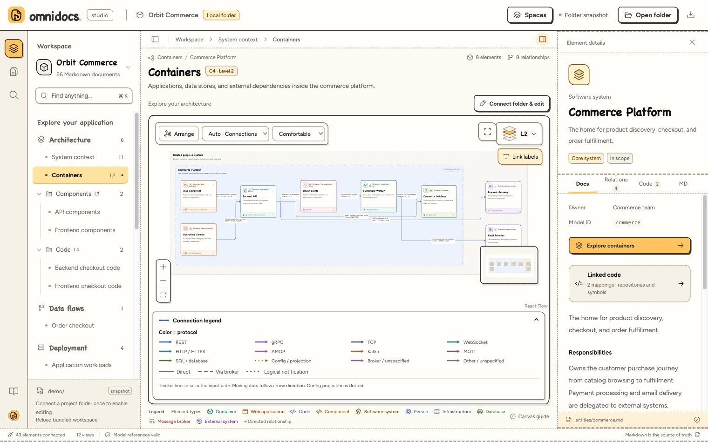
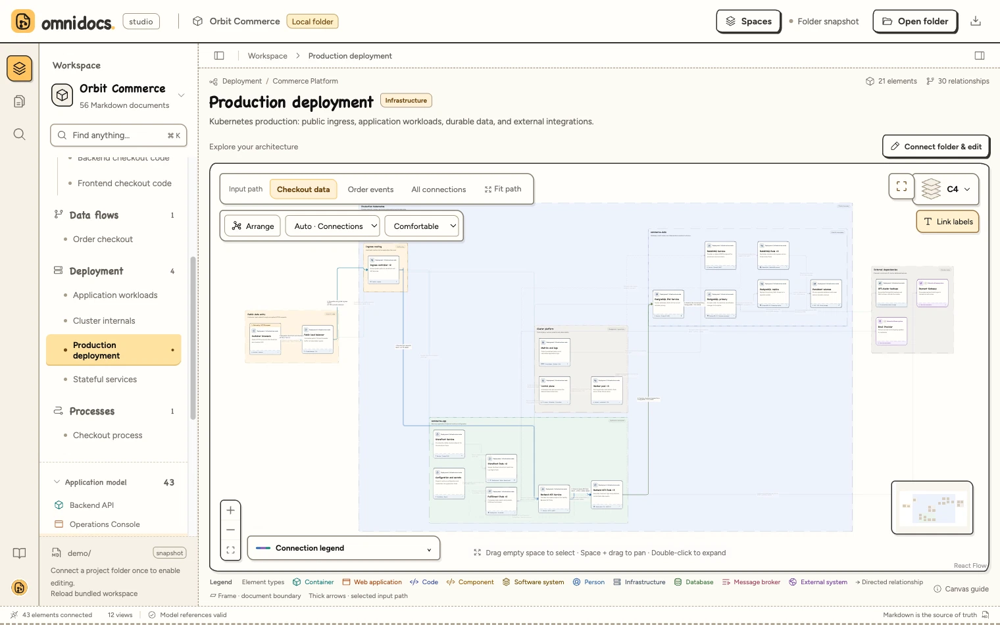

<p align="center">
  
</p>

<h1 align="center">OmniDocs Studio</h1>

<p align="center"><strong>A visual workspace for software architecture, powered by Markdown.</strong></p>

<p align="center">
  <a href="#quick-start">Quick start</a> ·
  <a href="#what-you-can-do">Features</a> ·
  <a href="#deployment">Deployment</a> ·
  <a href="#documentation">Documentation</a>
</p>

Open a folder of architecture documents and explore the system on an interactive canvas. Follow a connection to see what crosses it, expand a service to reveal its internals, or open the Markdown behind a diagram. Use OmniDocs on your own machine or host it for a team with accounts, permissions, and review history.



*Orbit Commerce is the fictional workspace included with OmniDocs.*

## What you can do

| Task | How OmniDocs helps |
| --- | --- |
| **Explore a system** | Navigate C4 context, container, component, and code views. Expand a system in place, focus its connections, and inspect protocols, payloads, and ownership boundaries. |
| **Trace a process** | Open ordered data flows, deployment diagrams, and BPMN processes. Follow links from process tasks back to their architecture elements. |
| **Edit the model** | Add or update elements and connections on the canvas. Review a draft before saving, and keep layout and viewport settings with the workspace. |
| **Review and share** | Organize spaces under projects and organizations, invite viewers or editors, create revocable read-only links, and review proposed changes against published versions. |

<details>
<summary>See the deployment and checkout process views</summary>




</details>

## Quick start

Requires Node.js 22.14 or later and npm.

```sh
npm ci
OMNIDOCS_DIR=docs/demo npm run studio
```

Open `http://127.0.0.1:4174`. In the demo, double-click **Commerce Platform** to reveal its containers, then expand **Backend API** to see its components. Use the sidebar to open **Production deployment**, **Order checkout**, or **Checkout process**.

To bring your own material, use **Open folder** in a supported desktop browser or point `OMNIDOCS_DIR` to a Markdown workspace. OmniDocs reads its own frontmatter format and supported Structurizr JSON snapshots embedded in Markdown. The [format guide](docs/FORMAT.md) and [Structurizr import guide](docs/STRUCTURIZR-IMPORT.md) show what to put in a folder.

## Deployment

| Mode | Start it with | Storage |
| --- | --- | --- |
| **Folder editor** | `npm run studio` | Markdown in the selected folder |
| **Personal service** | `npm run service:local` | SQLite and local workspace files |
| **Hosted service** | `./omnidocs setup` then `./omnidocs update` | PostgreSQL 18 and persistent Docker volumes |

The personal and hosted services share the same UI and account features. Personal mode runs on loopback without Docker. On first setup, the launcher prints the generated administrator and member credentials once. Hosted mode runs with Docker Compose and Caddy, with HTTPS and email delivery configured during setup. See [service setup and operations](docs/SERVICE.md).

For a single-file demo you can open directly in a browser, run `npm run build:portable`. The public demo is written to `output/OmniDocs-Studio.html`. To make a private export of your own workspace, pass `--include-configured-workspace` and choose a separate path with `OMNIDOCS_OUTPUT`.

## Documentation

- [Visual design system](docs/DESIGN.md)
- [Markdown input contract](docs/INPUT-CONTRACT.md)
- [Editing and persistence](docs/EDITING.md)
- [Accounts, sharing, review, and deployment](docs/SERVICE.md)

## Development

```sh
npm run dev
npm test
npm run build
```

Use `npm run dev` while working on the React and TypeScript frontend. The test suite uses the versioned demo and synthetic fixtures. Keep private workspaces under `projects/` and local service data under `.service-data/`. Git and Docker exclude those paths, along with local configuration and backups.
