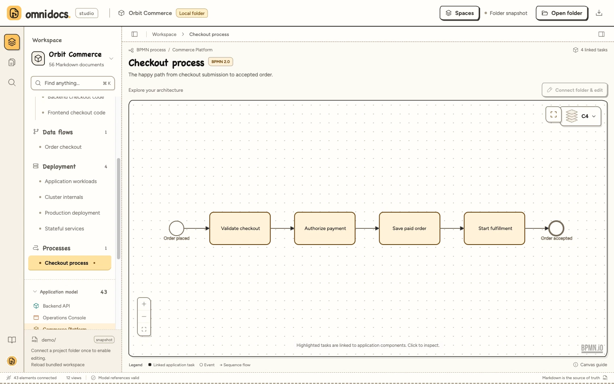

<p align="center">
  
</p>

<h1 align="center">OmniDocs Studio</h1>

<p align="center"><strong>A visual workspace for software architecture, powered by Markdown.</strong></p>

<p align="center">
  <a href="#quick-start">Quick start</a> ·
  <a href="#what-you-can-do">Features</a> ·
  <a href="#deployment">Deployment</a> ·
  <a href="#documentation">Documentation</a>
</p>

Open a folder of architecture documents and explore the system on an interactive canvas. Follow a connection to see what crosses it, expand a service to reveal its internals, or open the Markdown behind a diagram. Use OmniDocs on your own machine or host it for a team with accounts, permissions, and review history.


*Orbit Commerce is the fictional workspace included with OmniDocs.*

## What you can do

| Task | How OmniDocs helps |
| --- | --- |
| **Explore a system** | Navigate C4 context, container, component, and code views. Expand a system in place, focus its connections, and inspect protocols, payloads, and ownership boundaries. |
| **Trace a process** | Open ordered data flows, deployment diagrams, and BPMN processes. Follow links from process tasks back to their architecture elements. |
| **Edit the model** | Add or update elements and connections on the canvas. Review a draft before saving, and keep layout and viewport settings with the workspace. |
| **Review and share** | Organize spaces under projects and organizations, invite viewers or editors, create revocable read-only links, and review proposed changes against published versions. |

<details>
<summary>See the deployment and checkout process views</summary>




</details>

## Quick start

Requires Node.js 22.14 or later and npm.

```sh
npm ci
OMNIDOCS_DIR=docs/demo npm run studio
```

Open `http://127.0.0.1:4174`. In the demo, double-click **Commerce Platform** to reveal its containers, then expand **Backend API** to see its components. Use the sidebar to open **Production deployment**, **Order checkout**, or **Checkout process**.

To bring your own material, use **Open folder** in a supported desktop browser or point `OMNIDOCS_DIR` to a Markdown workspace. OmniDocs reads its own frontmatter format and supported Structurizr JSON snapshots embedded in Markdown. The [format guide](docs/FORMAT.md) and [Structurizr import guide](docs/STRUCTURIZR-IMPORT.md) show what to put in a folder.

## Run the service locally

Requires Node.js 22.14 or later and npm. From the repository root, run:

```sh
npm ci
npm run service:local
```

Open the URL printed in the terminal, usually `http://127.0.0.1:4174`. Add `/admin/` to open the admin panel. The first run prints separate administrator and member credentials. Local mode uses SQLite and workspace files under `.service-data/`. To open the admin panel directly on startup, use `npm run service:local -- --admin`.

## Run the service in production

On the deployment server, install Docker with Compose and run these commands from the OmniDocs source directory:

```sh
./omnidocs setup
./omnidocs update
./omnidocs status
```

In setup, choose HTTPS, enter the public hostname and port, configure the initial administrator and permitted management networks, and set up the mail webhook. The stack uses Caddy, PostgreSQL 18, and persistent volumes. Open the configured HTTPS URL and use `/admin/` from an allowed management network to sign in and enroll your authenticator. For later releases, update the source files and run `./omnidocs update`. See the [deployment guide](docs/SERVICE.md#public-deployment-configuration) for TLS, mail, and backup details.

## Enable or disable SSO

1. In OmniDocs, open **Admin → Settings → ZITADEL SSO** and copy the **Redirect URI**.
2. In ZITADEL, create a **Web** application using **PKCE** and register that exact URI. For a local HTTP callback, enable **Development Mode** in ZITADEL.
3. In OmniDocs, enter the ZITADEL **Issuer URL** (the instance's HTTPS origin) and **Client ID**. Click **Save ZITADEL settings**, then **Enable ZITADEL SSO**. The member sign-in page now shows **Login with SSO**.
4. To turn it off, return to the same settings and click **Disable ZITADEL SSO**. This blocks new sign-ins through SSO. Existing OmniDocs sessions stay active.

OmniDocs stores both settings in its database. Changing the issuer or Client ID disables SSO until you enable it again. Members need an active OmniDocs account with the same verified email in ZITADEL.

## Enable or disable email verification

Under **Admin → Settings → New accounts**, choose a mode and click **Save settings**.

| Mode | What happens to new accounts |
| --- | --- |
| **Email verification** | Users receive an email link to activate their account and choose a password. Production uses the configured mail webhook. Local service messages appear in `.service-data/development-mail/`. |
| **Administrator approval** | Users wait for an administrator to approve the account in **Admin → Users**. Send the user the one-time activation link privately. |
| **Automatic activation** | Available on loopback. Users set their password at signup and can sign in immediately. |

Choose **Administrator approval** to turn off automatic verification email in production. On loopback you can also choose **Automatic activation**. These settings apply to registration. Password reset and invitation emails use their own flows.

The sign-in and registration forms initially hide CAPTCHA. If the server requires it after an unsuccessful attempt, the form displays a security check for the retry.

## Offline editor

Run `npm run studio` for a local folder editor backed by Markdown.

For a single-file demo you can open directly in a browser, run `npm run build:portable`. The public demo is written to `output/OmniDocs-Studio.html`. To make a private export of your own workspace, pass `--include-configured-workspace` and choose a separate path with `OMNIDOCS_OUTPUT`.

## Documentation

- [Visual design system](docs/DESIGN.md)
- [Markdown input contract](docs/INPUT-CONTRACT.md)
- [Editing and persistence](docs/EDITING.md)
- [Accounts, sharing, review, and deployment](docs/SERVICE.md)

## Development

```sh
npm run dev
npm test
npm run build
```

Use `npm run dev` while working on the React and TypeScript frontend. The test suite uses the versioned demo and synthetic fixtures. Keep private workspaces under `projects/` and local service data under `.service-data/`. Git and Docker exclude those paths, along with local configuration and backups.
